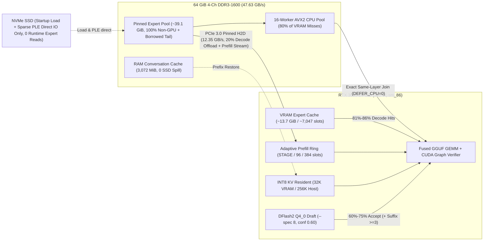

# Strata Ampere

[English](README.md) | [简体中文](README.zh-CN.md)

**Strata Ampere** is a Windows CUDA (`sm_86`) performance fork of [Strata v0.2.20](https://github.com/Niko1221/Strata/releases/tag/v0.2.20) (engine `0.1.66`) engineered to run **Qwen3.8-Flash-Next GSQ-RCO IQ3_S** (125B MoE, 6B active, 51B n-gram PLE, **256K context**, CUDA Vision) at **lossless quality** on a single **24 GiB NVIDIA RTX 3090 (300 W)** paired with **64 GiB DDR3 / Xeon E5-2696 v3 (PCIe 3.0 x16)**.

Through systematic hardware roofline measurement, profiler-driven bottleneck isolation, a 32-line chunk-adaptive prefill ring change ([`engine/src/prefill/prefill.cpp`](engine/src/prefill/prefill.cpp)), zero-SSD borrowed-slot memory budgeting, and DFlash2 speculative drafting, the production **`Candidate-2B-DF2`** profile improves real **96K coding decode by +50% to +54%** and **16K–32K cold prefill by +21% to +31%** over official Strata v0.2.20 — while keeping **every approximate shortcut disabled** and achieving **0 runtime SSD expert reads** up through 244K tokens.

---

## Headline Results

All benchmark figures below are **3-round measured medians** (`temperature=0`, fixed fixtures, same RTX 3090 @ 300 W, Windows `Balanced`, 256K context, CUDA Vision, all approximate switches `0`).

| Workload | Official Strata v0.2.20 (MTP) | Official Strata v0.2.20 (DFlash2) | Legacy `prefill-decode` (Repeat) | **`Candidate-2B-DF2` (Production)** | Gain vs Official |
| :--- | ---: | ---: | ---: | ---: | :--- |
| **Cold 4K Prefill** | 1,550.9 tok/s | 1,509.5 tok/s | 1,485.9 tok/s | **1,527.8 tok/s** | Parity (+2.8% vs legacy) |
| **Cold 16K Prefill** | 2,016.8 tok/s | 2,080.0 tok/s | 2,163.4 tok/s | **2,636.2 tok/s** | **+26.7% to +30.7%** |
| **Cold 32K Prefill** | 2,161.2 tok/s | 2,212.8 tok/s | 2,219.6 tok/s | **2,676.1 tok/s** | **+20.9% to +23.8%** |
| **Cold 96K TTFT** *(98,278 tok real code, n=1)* | 45.79 s | 45.60 s | 45.77 s | **39.25 s** | **−6.35 to −6.54 s (−14.2%)** |
| **Warm 32K Chat Decode** *(+264 tok)* | 117.2 tok/s | 126.1 tok/s | 132.0 tok/s | **145.4 tok/s** | **+15.3% to +24.1%** |
| **Real 96K Code Decode** *(512 tok out)* | 56.1 tok/s | 54.9 tok/s | 77.0 tok/s | **84.3 tok/s** | **+50.3% to +53.6%** |
| **Runtime Expert SSD Reads** *(native file events)* | 732–733 / cold read | 552–553 / cold read | 188 / cold read *(1,964 total)* | **0** | **100% eliminated** |
| **Lossless Quality Gate** *(160-pos TF KL, 16K / 96K)* | 0.000856 / 0.001648 *(self-retest)* | 0.000697 / 0.002502 | 0.000874 / 0.001753 | **0.000788 / 0.000814** | **Tighter than official self-noise; 8/8 code QA** |

**Production live validation (`free2` serving `262,144` context + CUDA Vision + 3 GiB RAM conversation cache):**
- **244,160-token multimodal cold stress test**: **2,377.7 tok/s** prefill (102.7 s), CUDA Vision OK, **0 SSD expert reads**, min free RAM **6.86 GiB**, min free VRAM **1,735 MiB**.
- **Real multi-turn coding/agent session (11K → 28.8K warmed context, 15 consecutive turns)**: **72.0–81.5 tok/s** decode (median **~75 tok/s**, up from ~57–62 tok/s previously), **81%–86%** VRAM expert hit rate, **99.88%** KV VRAM hit rate, **0 SSD reads**, GPU **51–55°C**.

---

## Hardware Roofline & Problem Statement

Running a 125B MoE model on a workstation built around a single 24 GiB GPU and DDR3 memory is a **memory-hierarchy and PCIe-scheduling problem**, not just a FLOPs problem. Every optimization in this repository was guided by measured hardware ceilings on the reference host:

| Subsystem | Reference Hardware & Measured Ceiling | Why It Matters |
| :--- | :--- | :--- |
| **GPU** | NVIDIA RTX 3090 24 GiB (`sm_86`, 82 SMs), **300 W** power limit *(default 390 W)* | Hits SW Power Cap at ~59–61°C during long cold prefill (no thermal throttling). Holds ~7,047–7,086 expert slots (~13.7 GiB) + dense layers + 32K INT8 KV + DFlash2 + Vision. |
| **PCIe Link** | Gen3 x16 — measured pinned H2D **12.35 GB/s** `[12.09–12.43]`, pageable **7.68 GB/s** | Narrow straw between 39+ GiB of RAM-resident experts and the GPU. Unhidden copies immediately stall `gemm gate/up`. |
| **CPU** | Intel Xeon E5-2696 v3 (Haswell-EP, 18C/36T, 45 MiB L3, **AVX2/FMA/F16C**, no AVX-512 / AVX-VNNI), Windows `Balanced` (~2.45 GHz load median) | Runs the 16-worker native CPU expert pool for VRAM misses during decode and short-chunk prefill. |
| **System RAM** | 64 GiB 4-channel DDR3-1600 ECC (HUANANZHI X99-TF) — measured 18-core AVX2 sequential read **47.63 GB/s** `[47.29–47.95]` (93% of 51.2 GB/s peak) | Must pin all non-GPU experts **plus** prefill borrowed-slot backups (~39.1–39.2 GiB) while keeping ≥6.8 GiB free for Windows + 3 GiB RAM conversation cache. |
| **Model Footprint** | **Qwen3.8-Flash-Next GSQ-RCO IQ3_S**: 48 MoE layers (36 GDN + 12 QSA), 512 routed experts/layer = **24,576 experts (46.84 GiB)**, top-10 + shared per token, plus 28.8 GB n-gram PLE (`--ple-io direct`) | Mixed GGML dtypes across layers: Gate/Up = 20× `IQ2_S`, 17× `IQ3_XXS`, 10× `IQ3_S`, 1× `IQ4_XS`; Down = 39× `IQ4_NL`, 9× `Q2_0`. |

**Core challenge:** 46.84 GiB of experts cannot fit in 24 GiB VRAM. To avoid catastrophic SSD fallback and PCIe stalls while keeping full 256K context and lossless output, VRAM, pinned RAM, PCIe DMA, CPU AVX2 workers, and speculative drafting must be balanced as one system.

---

## Architecture & Optimization Principles



Five concrete design decisions account for the gains:

### 1. Chunk-Adaptive Prefill Ring (`071ff14b7`, 32 lines in `prefill.cpp`)
- **Bottleneck discovered:** On cold 16K prefill with the default 96-slot ring, the GPU spent **1,330 ms (19.7% of GPU time)** in `wait copy` waiting on PCIe 3.0 expert transfers; on cold 96K prefill, `wait copy` reached **7,434 ms (17.3%)**.
- **Why global ring tuning failed:** Forcing `STRATA_PREFILL_RING=384` or `512` globally accelerated 16K/32K, but pushed 4K prompts into oversized staging and caused cold 4K prefill to regress from **1,514 → 1,097 tok/s**.
- **The fix:** [`engine/src/prefill/prefill.cpp`](engine/src/prefill/prefill.cpp) adds opt-in `STRATA_PREFILL_RING_LARGE` inside the single shared `ring_slots(T)` function used by both the scratch planner and live layout:
  - `T < stream_all_min()` (`STRATA_PREFILL_CPU_SHARE_MAX=6144`): stays on routed-only `STAGE` + CPU-assisted prefill → preserves fast 4K (**1,528–1,589 tok/s**).
  - `6144 <= T < 8192`: uses **96** slots.
  - `T >= 8192` (e.g., 16K chunks): expands to **384** slots (`STRATA_PREFILL_RING_LARGE=384`).
- **Measured effect:** `wait copy` collapses from **1,330 ms → 1 ms** (0.0%) on cold 16K and **7,434 ms → 438 ms** (1.2%) on cold 96K, boosting cold 16K/32K prefill by **+21%–31%** and cutting 96K cold TTFT by **6.5 seconds**.

### 2. Zero-SSD Borrowed-Slot Memory Math
- **Bottleneck discovered:** During 16K chunk prefill, Strata temporarily borrows ~2,644 VRAM expert slots (~5 GiB) for prefill workspace and ring staging. At the old budget (`--vram-reserve-mib 1600`, `--resident-budget-gib 38`, `HEADROOM=4`), RAM could only back 2,189–2,206 of those borrowed slots, leaving **~455 borrowed experts unbacked in RAM** — causing **178–733 native SSD file reads** per cold prompt (and **1,458–1,496** at 32K chunks).
- **The fix:**
  - Lock `--prefill auto:16384` (never `auto:32768`, whose larger borrow exceeds RAM backing).
  - Trim `--vram-reserve-mib` from `1600` → **`1200`** (+220–240 permanent VRAM expert slots → **~7,047–7,086 slots**, still leaving **1.6–1.7 GiB** free VRAM with zero WDDM spill).
  - Raise `--resident-budget-gib` from `38` → **`40`** with `STRATA_RESIDENT_HEADROOM_GIB=2`, pinning **39.12–39.20 GiB** of experts in RAM.
- **Measured effect:** 100% of non-GPU experts **and** 100% of the 16K borrowed tail stay resident in pinned RAM → **0 native SSD expert reads** across 4K, 16K, 32K, 96K, and 244K workloads, while preserving **6.86–7.65 GiB** free physical RAM (with 3 GiB conversation cache active).

### 3. DFlash2 Q4_0 Speculative Drafting (`--spec 8 --draft-conf 0.60`, default `--suffix-draft 3`)
- **Why DFlash2 wins on real coding:** On real 96K multi-turn code generation, DFlash2 Q4_0 achieves **2.78 tokens/window** (and **4.92 tokens/window** on 32K warm chat) at ~2.0 ms draft cost, compared to MTP's 2.20 / 3.66 tokens/window. Because each verification window pays a relatively fixed CPU/GPU synchronization cost (~28–35 ms), higher accepted tokens per window translate directly into higher decode tok/s (**84.3 vs 77.8 tok/s** on real 96K code, **+8.4%** over tuned MTP and **+50%–54%** over official baselines).
- **Why default `--suffix-draft 3` matters:** `--suffix-draft N` sets the **minimum suffix match length** (not the draft length). Raising it to 12 in early screening suppressed suffix reuse and hurt 96K decode (`72.7 tok/s`); keeping the default `3` preserves lossless copy acceleration.
- **Loader detail:** Strata Control resolves DFlash2 defaults on reload, so [`tools/ampere/prepare_profile.py`](tools/ampere/prepare_profile.py) writes `--draft-model`, `--spec 8`, and `--draft-conf 0.60` into both `args` and `user_args`.

### 4. Host-Side Verify Planning + Calibrated PCIe/CPU Split (`--pcie-frac 0.20`)
- **Bottleneck discovered:** On RTX 3090, Strata's default `STRATA_VERIFY_DEVICE_HITS=1` forces effective `--pcie-frac` to **`0.00`** (`generate.cpp:21338`), dumping 100% of VRAM-missed experts onto the Haswell DDR3 CPU pool while leaving the 12.35 GB/s PCIe 3.0 link idle during decode.
- **The fix:** Set `STRATA_VERIFY_DEVICE_HITS=0` and `STRATA_VERIFY_DEVICE_PLAN=0` to enable host-side planning, then calibrate `--pcie-frac` directly on real 96K code:
  - DFlash2 sweep (`0.15 / 0.20 / 0.25`): `37.68 / 34.77 / 45.82 ms/window` → **`0.20`** selected.
  - MTP sweep (`0.15 / 0.20 / 0.25`): `29.20 / 30.48 / 27.69 ms/window` → `0.25` selected.

### 5. Strictly Lossless by Default (Opt-In Deferral Preserved, Disabled in Production)
- Earlier commits in this fork (`3ab511dc7`) ported opt-in **CPU expert deferral** (`STRATA_VERIFY_DEFER_CPU=1`, `STRATA_VERIFY_DEFER_CPU_BELOW=0.1`) from Strata PRs [#2689](https://github.com/Niko1221/Strata/pull/2689) and [#2690](https://github.com/Niko1221/Strata/pull/2690), which overlaps low-weight CPU expert computations with the next layer's attention/mixer at the cost of altering the residual seen by that mixer.
- In **`Candidate-2B-DF2`**, **all four approximate switches are explicitly `0`**: `STRATA_VERIFY_DEFER_CPU=0`, `STRATA_ROUTE_TAIL_SKIP=0`, `STRATA_ROUTE_PRIOR=0`, `STRATA_KVA=0`. Every routed expert is computed and combined in its exact layer before the next layer begins. The opt-in deferral feature remains available in the binary for users who wish to benchmark or enable it explicitly.

---

## Detailed Benchmarks, Quality Proof & Profiler Breakdown

### 1. Full 5-Workload 3-Round Benchmark (`median [min–max]`)

| Profile | Cold 4K Prefill *(tok/s)* | Cold 16K Prefill *(tok/s)* | Cold 32K Prefill *(tok/s)* | Cold 96K TTFT *(s, n=1)* | Warm 32K Decode *(tok/s)* | Real 96K Code Decode *(tok/s)* | Real 96K TTFT *(s)* | Pinned RAM *(GiB)* | Native File Events |
| :--- | ---: | ---: | ---: | ---: | ---: | ---: | ---: | ---: | ---: |
| `Base-Official-MTP` | 1,550.9 `[1,536–1,575]` | 2,016.8 `[2,013–2,025]` | 2,161.2 `[2,139–2,163]` | 45.794 | 117.2 `[114.7–118.5]` | 56.1 `[55.5–60.1]` | 1.309 | 38.00 | 732–733 / cold |
| `Base-Official-DFlash2` | 1,509.5 `[1,500–1,521]` | 2,080.0 `[2,072–2,085]` | 2,212.8 `[2,208–2,218]` | 45.595 | 126.1 `[121.4–127.3]` | 54.9 `[51.7–59.1]` | 1.219 | 38.00 | 552–553 / cold |
| `Curr-PrefillDecode` *(repeat)* | 1,485.9 `[1,459–1,525]` | 2,163.4 `[2,156–2,169]` | 2,219.6 `[2,218–2,226]` | 45.765 | 132.0 `[130.1–133.0]` | 77.0 `[67.5–97.5]`* | 1.148 | 38.00 | 1,964 total |
| `Candidate-2B-MTP` | **1,589.2** `[1,512–1,594]` | 2,623.7 `[2,601–2,625]` | 2,667.5 `[2,665–2,674]` | **38.848** | 140.6 `[139.9–142.5]` | 77.8 `[70.9–85.3]` | 1.176 | 39.20 | **0** |
| **`Candidate-2B-DF2`** | 1,527.8 `[1,475–1,579]` | **2,636.2** `[2,633–2,641]` | **2,676.1** `[2,664–2,681]` | 39.249 | **145.4** `[135.8–145.6]` | **84.3** `[69.6–95.1]` | **1.112** | 39.12 | **0** |

*\*Note on variance:* In an earlier Phase 2A run, `Curr-PrefillDecode` recorded a 96K median of `104.7 tok/s [69.6–133.8]` because two turns triggered 41–44 long suffix matches (`7.88–8.83 tok/window`). In the same-order Phase 2B repeat above, it measured `77.0 tok/s [67.5–97.5]`. Comparing `Candidate-2B-MTP` against `Curr-PrefillDecode (repeat)` isolates the pure engine + memory gain (+21.3% cold 16K prefill, −6.9 s 96K TTFT, 0 file reads); switching from MTP to DFlash2 Q4_0 adds another +8.4% on real 96K code decode.

### 2. Lossless Fidelity Verification (160-Position Teacher-Forced Logprobs + Code QA)

Every candidate was evaluated against the original Official MTP reference token sequence using native teacher-forced top-20 logprob distributions (merged tail bucket) plus 8 independent no-hint source-code factual questions:

| Profile | Workload | Aligned Pos | Top-1 Diff | Merged KL (nats) | Merged L1 | Mean `\|Δlogp\|` | Code QA |
| :--- | :--- | ---: | ---: | ---: | ---: | ---: | ---: |
| `Base-Official-MTP` *(self-retest)* | Cold 16K | 160 | 0.62% | 0.000856 | 0.014155 | 0.008838 | 8/8 |
| `Base-Official-MTP` *(self-retest)* | Real 96K | 160 | 1.25% | 0.001648 | 0.016322 | 0.010905 | 8/8 |
| `Candidate-2B-MTP` | Cold 16K | 160 | 0.00% | 0.001010 | 0.014045 | 0.008811 | 8/8 |
| `Candidate-2B-MTP` | Real 96K | 160 | 1.25% | 0.001871 | 0.017533 | 0.012305 | 8/8 |
| **`Candidate-2B-DF2`** | **Cold 16K** | **160** | **0.62%** | **0.000788** | **0.013719** | **0.009376** | **8/8** |
| **`Candidate-2B-DF2`** | **Real 96K** | **160** | **1.25%** | **0.000814** | **0.012325** | **0.008509** | **8/8** |

`Candidate-2B-DF2`'s KL divergence is **strictly tighter than Official MTP's own run-to-run floating-point reduction variance** on both 16K (`0.000788 < 0.000856`) and 96K (`0.000814 < 0.001648`).

### 3. Where Time Still Goes (`Candidate-2B-DF2` Profiler Breakdown)

| Workload | Total Profiled Time | Dominant Stages | Bottleneck Diagnosis |
| :--- | :--- | :--- | :--- |
| **Cold 16K Prefill** | 5,588 ms GPU | `gemm gate/up` 1,531 ms (27.4%) · `gdn` 844 ms (15.1%) · `gdn recurrence` 453 ms (8.1%) · `qsa attn` 423 ms (7.6%) · `wait copy` **1 ms (0.0%)** | Compute & 300 W GPU power-cap bound; PCIe H2D completely hidden. |
| **Cold 96K Prefill** | 37,500 ms GPU | `gemm gate/up` 9,413 ms (25.1%) · `gdn` 5,029 ms (13.4%) · `qsa attn` 2,759 ms (7.4%) · `qsa select` 2,755 ms (7.3%) · `gdn recurrence` 2,718 ms (7.2%) · `wait copy` **438 ms (1.2%)** | Down from 7,434 ms (17.3%) `wait copy`; now GPU compute + 300 W power-cap bound. |
| **303-tok Incremental Prefill** | ~1.11 s TTFT | `wait copy` 348 ms (47.4% GPU, 2,277 DMA experts) overlapped with `CPU join` 383 ms (3,777 CPU experts / 10,342 rows) | Dual-bound by Haswell CPU compute and PCIe 3.0 weight delivery (~4.4 GB/s request-level effective payload). |
| **Real 96K Decode** | 28.94 ms/window *(2.14 tok/win sample)* | `cpu_expert` 11.52 ms (39.8%) · `GPU waitCPU + waitB` 8.84 ms (30.5%) · `draft` 2.10 ms (7.3%) · `QSA kv-resolve` **0.37 ms (1.3%)** | CPU averages 3.22 experts/layer-window (~27.6 GB/s effective mixed-dtype throughput vs 47.63 GB/s DDR3 sequential peak). KV resolution is negligible. |

---

## Engineering Lessons: What We Tested and Rejected

To save other contributors from repeating dead ends on Ampere + Haswell / PCIe 3.0 Windows rigs, every negative ablation is recorded here:

| Experiment | Measured Result | Why It Was Rejected |
| :--- | :--- | :--- |
| `--prefill auto:32768` + global `STRATA_PREFILL_RING=512` | Cold 4K dropped **1,514 → 1,097 tok/s**; 32K/96K triggered **1,458–1,496 SSD reads** | 32K chunks borrow more VRAM slots than 64 GiB RAM can back; global 512-slot ring penalized short chunks. Replaced by `auto:16384` + chunk-adaptive `RING_LARGE=384`. |
| `--suffix-draft 12` | Real 96K decode dropped to **72.7 tok/s** | Flag sets *minimum match length* (not draft length); `12` prevented suffix drafting from firing. Keep default `3`. |
| `--kv-resident 131072` | Cold 16K **−12.1%** (1,996 tok/s), 96K decode **75.1 tok/s**, **836 SSD reads** | Stole VRAM from expert slots to optimize `QSA kv-resolve`, which only costs **0.37 ms/window**. Keep `--kv-resident 32768`. |
| `--ple-io mmap` | Cold 96K TTFT exploded **43.8 s → 115.9 s** | Windows mmap paging stalled sparse n-gram lookups. Always use `--ple-io direct`. |
| Windows `High Performance` power plan | Cold 4K decode **+13.7%** (107.4 → 122.1), but real 96K decode **−8.8%** (84.3 → 76.9; CPU expert 14.90 → 16.80 ms/win) | Boosting CPU frequency from 2.45 → 3.18 GHz did not improve real 96K steady-state decode on this machine; kept `Balanced`. |
| CUDA `IQ2_S` 128-row tile & `cp.async` staged kernel | Bit-exact output hashes verified (`1a5f29d44417645e` / `3db9fa3bc42ce0a4`), but `cp.async` regressed cold 16K **2,662 → 2,525 tok/s** (`gemm gate/up` 1,505 → 1,635 ms) | Under `sm_86` register & 300 W power pressure, extra staging hurt end-to-end throughput. Cleanly withdrawn. |
| Haswell AVX2 Gate/Up pair, register-index grid, 2-row `IQ4_NL` down, heavy-expert PCIe priority | All bit-exact verified; Gate/Up pair regressed 96K (`27.84 → 30.89 ms/win`); 2-row `IQ4_NL` <5% microbench; heavy-expert only −0.9% window | MSVC 19.44 + Haswell AVX2 (no AVX-512/VNNI) hit diminishing returns; no net end-to-end win worth code complexity. Cleanly withdrawn. |
| Built-in flags (`GDN_TC`, `GDN_CONVL2`, `GDN_CHUNKED=2`, `PREFILL_BF16X2`, `QSA_V1_PREFETCH`, `ADAPT_OVERLAP`, `SPEC_SPLIT`, `GDN_SPLIT`) | `ADAPT_OVERLAP` dropped 96K to **55.8 tok/s (−32.7%)**; `SPEC_SPLIT` **−13.3%**; `PREFILL_BF16X2` cold 16K **−9.9%**; `GDN_SPLIT` crashed on 12-tok batched commit | None improved `sm_86` end-to-end performance; `GDN_CHUNKED=1` requires 128 SMs (3090 has 82). |
| Resident-mode `STRATA_ADAPT_FETCH=2` | Architectural stop-loss | Requires transactional D2H eviction swaps and fault recovery for unbacked VRAM slots; risk exceeded value. |

---

## Remaining Hardware Headroom

Software scheduling on `Candidate-2B-DF2` has eliminated runtime SSD I/O and hidden PCIe H2D during long prefill (`wait copy` down to 0.0%–1.2%). The remaining ceilings are physical:
1. **300 W GPU Power Cap:** The RTX 3090 runs at 300 W (factory default 390 W) and actively hits `SW Power Cap` at ~60°C during long cold prefill. Raising the power limit is the single largest untouched hardware lever for cold 16K–256K prefill.
2. **Host Platform Bandwidth:** Moving from PCIe 3.0 x16 (12.35 GB/s) + Haswell DDR3-1600 (47.63 GB/s, AVX2) to PCIe 4.0 + DDR4/DDR5 + AVX-512/AMX directly accelerates both the 303-token incremental prefill (`wait copy` + `CPU join`) and the 11.5 ms/window decode CPU expert compute.

---

## Branches & Profiles

| Branch / Tag | Engine Commit | Drafting & Mode | Recommended Use |
| :--- | :--- | :--- | :--- |
| **`ampere`** *(default, recommended)* / `ampere-opt-2b` | `071ff14b7` *(adaptive ring + short-chunk diag)* | **DFlash2 Q4_0** (`--spec 8 --draft-conf 0.60`), `--pcie-frac 0.20`, **lossless** (`DEFER_CPU=0`), 40 GiB RAM / 1200 MiB VRAM reserve | Best overall lossless prefill + real long-context decode on 24 GiB Ampere + 64 GiB RAM. |
| `prefill-decode` | `3ab511dc7` | MTP (`--spec 4 --spec-min-p 0.65`), `--prefill auto:16384`, lossless (`DEFER_CPU=0`), 38 GiB RAM / 1600 MiB reserve | Legacy MTP-only profile before Phase 2B optimization. |
| `v0.2.20-ampere.2` *(tag)* | `3ab511dc7` | MTP (`--spec 4 --spec-min-p 0.5`), opt-in `STRATA_VERIFY_DEFER_CPU=1` (threshold `0.1`) | Initial native Strata API baseline with opt-in CPU expert deferral. |

---

## Quick Start (Build, Reproduce & Verify)

Full step-by-step instructions, drain-and-restart deployment, and rollback procedures live in **[`docs/AMPERE_WINDOWS.md`](docs/AMPERE_WINDOWS.md)**.

### 1. Build the Windows `sm_86` Engine
From a Visual Studio 2022 x64 Developer Shell with CMake, Ninja, and CUDA 13 on `PATH`:

```powershell
cmake -S engine -B build-ampere -G Ninja `
  -DCMAKE_BUILD_TYPE=Release -DCMAKE_CUDA_ARCHITECTURES=86 `
  -DCMAKE_CUDA_RUNTIME_LIBRARY=Shared -DSTRATA_ENABLE_CUDA=ON `
  -DSTRATA_PORTABLE=ON -DSTRATA_NATIVE_EXPERTS=ON -DSTRATA_BUILD_TESTS=OFF `
  -DSTRATA_BUILD_INKLING=OFF -DSTRATA_BUILD_INKLING2=OFF
cmake --build build-ampere --target strata --parallel 4
.\build-ampere\strata.exe --version
```

Place `strata-vision.exe` from the [Strata v0.2.20 Windows CUDA 13 release](https://github.com/Niko1221/Strata/releases/download/v0.2.20/strata-engine-0.1.66-windows-x86_64-cuda-cuda13.tar.gz) beside your built executable.

### 2. Generate the `Candidate-2B-DF2` Production Profile
Starting from an existing Windows Ampere IQ3_S profile (with CUDA Vision and model paths configured) plus the local DFlash2 Q4_0 pack:

```powershell
python .\tools\ampere\prepare_profile.py --candidate-2b-df2 `
  --profile $ActiveProfile `
  --engine $CandidateEngine `
  --draft-model $DFlash2Q4Pack `
  --draft-vocab $DraftVocab `
  --cuda-bin $CudaBin `
  --out $CandidateProfile
```

*(For tighter memory hosts, `prepare_profile.py` also accepts `--resident-budget-gib 39` and `--vram-reserve-mib 1400`.)*

### 3. Serve & Verify
```powershell
Set-Location .\terminal
python -m serve.server --engine strata --config $CandidateProfile --host 127.0.0.1 --port 8080
```

- Open `http://127.0.0.1:8080/#monitor` for the live Monitor UI; OpenAI (`/v1/chat/completions`, `/v1/responses`) and Anthropic (`/v1/messages`) endpoints are served on `/v1`.
- Confirm in the startup log & `/metrics`: `drafting: dflash2`, `spec: 8`, `pcie_frac: 0.20`, `prefill_cap: 16384`, `stream_all_min: 6144`, `file_blobs: 0`, and healthy RAM/VRAM headroom.
- See [`docs/DETAILS.md`](docs/DETAILS.md) for the full upstream Strata API and runtime reference.

---

## Attribution & License

- Base engine, HTTP server, and Monitor: [Strata](https://github.com/Niko1221/Strata) (`v0.2.20` / engine `0.1.66`).
- Opt-in CPU expert deferral (`3ab511dc7`): lask3802's Strata [#2689](https://github.com/Niko1221/Strata/pull/2689) and [#2690](https://github.com/Niko1221/Strata/pull/2690), including cold-batch adaptation credited in the [Speedy v0.5.4 NOTICE](https://github.com/DevDock-AI/Speedy/blob/v0.5.4/NOTICE).
- Benchmark model & weights: [Qwen3.8-Flash-Next](https://huggingface.co/Qwen/Qwen3.8-Flash-Next) and [ISTA-DASLab GSQ-RCO GGUF](https://huggingface.co/ISTA-DASLab/Qwen3.8-Flash-Next-GSQ-RCO-GGUF).

Distributed under the [MIT License](LICENSE). Bundled third-party components carry their own license notices.
