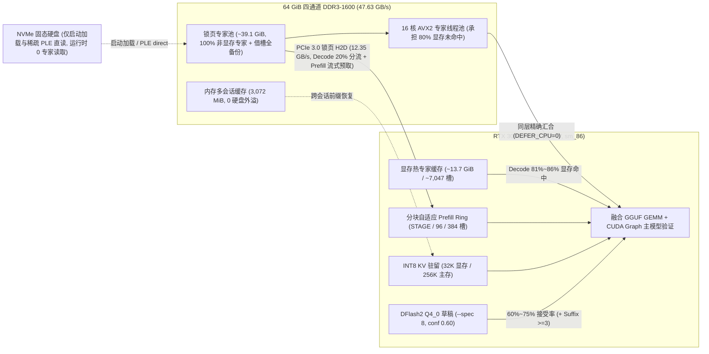

# Strata Ampere

[English](README.md) | [简体中文](README.zh-CN.md)

**Strata Ampere** 是基于 [Strata v0.2.20](https://github.com/Niko1221/Strata/releases/tag/v0.2.20)（引擎 `0.1.66`）打造的 Windows CUDA（`sm_86`）性能优化分支，核心目标是在**单卡 24 GiB NVIDIA RTX 3090（锁 300 W 功耗墙）+ 64 GiB DDR3 / Xeon E5-2696 v3（PCIe 3.0 x16）** 平台上，以**严格无损质量**流畅运行 **Qwen3.8-Flash-Next GSQ-RCO IQ3_S**（125B MoE / 6B 激活 / 51B n-gram PLE / **完整 256K 上下文** / CUDA 视觉）。

通过系统性的硬件天花板摸底、内置 Profiler 逐阶段瓶颈拆解、32 行源码改造的分块自适应 Prefill Ring（[`engine/src/prefill/prefill.cpp`](engine/src/prefill/prefill.cpp)）、零 SSD 回读的借槽内存预算配平，以及 DFlash2 投机草稿调优，最终上线的 **`Candidate-2B-DF2`** 档位相比官方 Strata v0.2.20 实现了 **真实 96K 代码续聊 Decode +50% ~ +54%**、**16K–32K 冷读 Prefill +21% ~ +31%** 的实测提速，同时**关闭全部近似妥协开关**，并在最高 244K 上下文压力测试中保持 **0 次运行时 SSD 专家文件读取**。

---

## 核心实测成绩一览

以下基准均为**同机三轮实测中位数**（`temperature=0`，固定真实代码与对话语料，RTX 3090 锁 300 W，Windows `平衡` 电源计划，完整 256K 上下文，CUDA 视觉开启，全部近似开关置 `0`）。

| 测试负载 | 官方 Strata v0.2.20 (MTP) | 官方 Strata v0.2.20 (DFlash2) | 旧版 `prefill-decode` (同序复测) | **`Candidate-2B-DF2`（当前生产版）** | 相对官方提升 |
| :--- | ---: | ---: | ---: | ---: | :--- |
| **冷 4K 预填 (Prefill)** | 1,550.9 tok/s | 1,509.5 tok/s | 1,485.9 tok/s | **1,527.8 tok/s** | 持平（较旧版 +2.8%） |
| **冷 16K 预填 (Prefill)** | 2,016.8 tok/s | 2,080.0 tok/s | 2,163.4 tok/s | **2,636.2 tok/s** | **+26.7% ~ +30.7%** |
| **冷 32K 预填 (Prefill)** | 2,161.2 tok/s | 2,212.8 tok/s | 2,219.6 tok/s | **2,676.1 tok/s** | **+20.9% ~ +23.8%** |
| **冷 96K 首字耗时 (TTFT)** *(98,278 tok 真实代码, n=1)* | 45.79 s | 45.60 s | 45.77 s | **39.25 s** | **缩短 6.35 ~ 6.54 s (−14.2%)** |
| **暖 32K 续聊生成 (Decode)** *(+264 tok)* | 117.2 tok/s | 126.1 tok/s | 132.0 tok/s | **145.4 tok/s** | **+15.3% ~ +24.1%** |
| **真实 96K 代码续聊 (Decode)** *(生成 512 tok)* | 56.1 tok/s | 54.9 tok/s | 77.0 tok/s | **84.3 tok/s** | **+50.3% ~ +53.6%** |
| **运行时 SSD 专家读取次数** *(native 文件事件)* | 732–733 次 / 冷读 | 552–553 次 / 冷读 | 188 次 / 冷读 *(全轮累计 1,964)* | **0 次** | **彻底清零** |
| **无损精度门禁** *(160 位 TF KL，16K / 96K)* | 0.000856 / 0.001648 *(官方自复测)* | 0.000697 / 0.002502 | 0.000874 / 0.001753 | **0.000788 / 0.000814** | **优于官方自复测噪声；代码问答 8/8** |

**生产线上实跑验证（`262,144` 上下文 + CUDA 视觉 + 3 GiB 内存多会话缓存）：**
- **244,160 token 多模态极限冷读压测**：预填 **2,377.7 tok/s**（102.7 秒），CUDA 识图通过，**0 次 SSD 专家读取**，最低可用物理内存 **6.86 GiB**，最低空闲显存 **1,735 MiB**。
- **真实多轮代码/对话实测（11K → 28.8K 热态连续 15 轮）**：稳定生成 **72.0 ~ 81.5 tok/s**（中位数约 **75 tok/s**，旧版同场景约 57 ~ 62 tok/s），显存专家命中率 **81% ~ 86%**，KV 显存命中率 **99.88%**，**0 次 SSD 读取**，GPU 温度 **51 ~ 55°C**。

---

## 硬件天花板与核心挑战

在单张 24 GiB 显卡 + 老平台 DDR3 内存上跑 125B MoE，本质上是一场**多级存储调度与 PCIe 带宽掩盖战**，而不是单纯拼显卡算力。我们首先实测了基准主机的各项物理上限：

| 子系统 | 基准硬件与实测天花板 | 对推理的决定性约束 |
| :--- | :--- | :--- |
| **GPU** | NVIDIA RTX 3090 24 GiB（`sm_86`, 82 SM），功耗锁 **300 W** *(默认 390 W)* | 长文本冷预填在 ~59–61°C 触发 `SW Power Cap`（无热降频）。显存需同时容纳 ~7,047–7,086 个专家槽（~13.7 GiB）、稠密层、32K INT8 KV、DFlash2 草稿与视觉模型。 |
| **PCIe 通道** | Gen3 x16 — 实测锁页 H2D **12.35 GB/s** `[12.09–12.43]`，非锁页 **7.68 GB/s** | 39+ GiB 内存常驻专家流向 GPU 的细吸管。只要异步传输藏不住，计算流立刻在 `wait copy` 停摆。 |
| **CPU** | Intel Xeon E5-2696 v3（Haswell-EP, 18C/36T, 45 MiB L3，支持 **AVX2/FMA/F16C**，无 AVX-512 / AVX-VNNI），Windows `平衡`（负载中位 ~2.45 GHz） | 承担 Decode 阶段和短续聊 Prefill 阶段中，显存未命中专家的 16 线程原生 AVX2 计算。 |
| **系统内存** | 64 GiB 四通道 DDR3-1600 ECC（华南 X99-TF）— 实测 18 核 AVX2 顺序读 **47.63 GB/s** `[47.29–47.95]`（理论 51.2 GB/s 的 93%） | 必须同时锁页装下全部非 GPU 专家 + Prefill 借槽备份（~39.1–39.2 GiB），还要留出 ≥6.8 GiB 给 Windows 与 3 GiB 对话缓存。 |
| **模型规模** | **Qwen3.8-Flash-Next GSQ-RCO IQ3_S**：48 层 MoE（36 层 GDN + 12 层 QSA），每层 512 专家 = **24,576 个专家（46.84 GiB）**，每 token top-10 + 共享专家；另有 28.8 GB n-gram PLE（`--ple-io direct`） | 各层采用混合 GGML 量化：Gate/Up 为 20 层 `IQ2_S`、17 层 `IQ3_XXS`、10 层 `IQ3_S`、1 层 `IQ4_XS`；Down 为 39 层 `IQ4_NL`、9 层 `Q2_0`。 |

**核心矛盾：** 46.84 GiB 专家不可能全塞进 24 GiB 显存。必须在**不降上下文（保 256K）、不碰硬盘（0 SSD 读）、不损精度（全精确计算）**的前提下，让显存、锁页内存、PCIe 3.0、Haswell 16 核与投机草稿协同踩在物理上限上。

---

## 整体架构与五大核心优化原理



最终提速并非玄学调参，而是环环相扣的五个工程原理：

### 1. 分块自适应 Prefill Ring（`071ff14b7`，`prefill.cpp` 仅 32 行改动）
- **问题根因：** 默认 96 槽 Ring 在 16K 大 chunk 冷读时深度不够，PCIe 3.0 预取跑不过 GPU 的 `gemm gate/up`，导致冷 16K 中 GPU 光等拷贝（`wait copy`）就浪费 **1,330 ms（占 GPU 时间线 19.7%）**，冷 96K 更是高达 **7,434 ms（17.3%）**。
- **为什么粗暴全局改大不行：** 直接设全局 `STRATA_PREFILL_RING=384/512` 虽然拉快了 16K/32K，却让 4K 短提示掉进过重的大流式路径，冷 4K 暴跌 **1,514 → 1,097 tok/s**。
- **核心解法：** 在 [`engine/src/prefill/prefill.cpp`](engine/src/prefill/prefill.cpp) 共享的 `ring_slots(T)` 中引入 `STRATA_PREFILL_RING_LARGE`（同时统一 scratch 规划与运行期布局）：
  - `T < stream_all_min()`（配合 `STRATA_PREFILL_CPU_SHARE_MAX=6144`）：保持按路由暂存 `STAGE` + CPU 助算，保住 4K 满速（**1,528 ~ 1,589 tok/s**）。
  - `6144 <= T < 8192`：维持 **96** 槽。
  - `T >= 8192`（16K 大 chunk）：自动切换 **384** 槽深 Ring（`STRATA_PREFILL_RING_LARGE=384`）。
- **实测效果：** 冷 16K 的 `wait copy` 从 **1,330 ms 直降到 1 ms（0.0%）**，冷 96K 从 **7,434 ms 降到 438 ms（1.2%）**，长预填直接提速 **+21% ~ +31%**，96K 冷首字快了 **6.5 秒**。

### 2. 零 SSD 回读的「借槽内存账本」配平
- **问题根因：** 16K 大 chunk 预填需要临时向显存借约 2,644 个专家槽（~5 GiB）当工作区与 Ring。旧档位（`--vram-reserve-mib 1600`、`--resident-budget-gib 38`、`HEADROOM=4`）在内存中只来得及给其中 2,189 ~ 2,206 个借槽留备份，导致 **约 455 个被借走的专家没内存备份**，一跑长预填就触发 **178 ~ 733 次原生 SSD 文件回读**（切到 32K chunk 甚至暴增到 **1,458 ~ 1,496 次**）。
- **核心解法：**
  - 锁死 `--prefill auto:16384`（绝不盲目上 `auto:32768`）。
  - 显存预留从 `1600` 收紧到 **`1200 MiB`**，多换出 ~220–240 个常驻显存专家槽（总计 **~7,047–7,086 槽**），同时保持 **1.6 ~ 1.7 GiB** 显存余量且无 WDDM 溢写。
  - 锁页内存上限从 `38` 提到 **`40 GiB`**、预留 `STRATA_RESIDENT_HEADROOM_GIB=2`，实际稳定锁页 **39.12 ~ 39.20 GiB**。
- **实测效果：** 100% 非显存专家 + 100% 16K 借槽尾段全部留在锁页内存里——4K / 16K / 32K / 96K / 244K 全程 **0 次 SSD 专家读取**，同时整机（含 3 GiB 多会话缓存）仍剩 **6.86 ~ 7.65 GiB** 可用物理内存。

### 3. DFlash2 Q4_0 投机草稿（`--spec 8 --draft-conf 0.60`，保持默认 `--suffix-draft 3`）
- **为什么 DFlash2 胜过 MTP：** 在真实 96K 代码续聊中，DFlash2 Q4_0 每次草稿仅花 ~2.0 ms，却能把单次验证窗口的平均产出拉到 **2.78 token/window**（暖 32K 达 **4.92 token/window**），明显高于 MTP 的 2.20 / 3.66。由于每个验证窗口的 CPU/GPU 协同底噪相对固定（~28–35 ms），单窗多吃进的 token 直接兑现为更高的真实生成速度（96K 代码 **84.3 vs 77.8 tok/s**，比同优化 MTP 再快 **+8.4%**，比官方快 **+50% ~ +54%**）。
- **为什么必须保留默认 `--suffix-draft 3`：** 该参数含义是**触发后缀匹配的最短长度**而非草稿长度。早期误调成 12 反而导致后缀匹配几乎不触发，96K Decode 跌到 72.7 tok/s；保持默认 3 才能在改代码/续写场景白嫖无损加速。
- **配置持久化细节：** Strata Control 重载时会按默认规则重写 DFlash2 参数，因此 [`tools/ampere/prepare_profile.py`](tools/ampere/prepare_profile.py) 同时把 `--draft-model`、`--spec 8`、`--draft-conf 0.60` 写入 `args` 与 `user_args`。

### 4. 主机侧验证规划 + 实测标定的 PCIe/CPU 分工（`--pcie-frac 0.20`）
- **问题根因：** 在 RTX 3090 上，Strata 默认开启 `STRATA_VERIFY_DEVICE_HITS=1`，会强制把运行期 `--pcie-frac` 清零（`generate.cpp:21338`），导致所有显存未命中专家全压在 Haswell DDR3 CPU 上，白白闲置了 12.35 GB/s 的 PCIe 3.0 带宽。
- **核心解法：** 显式置 `STRATA_VERIFY_DEVICE_HITS=0` 和 `STRATA_VERIFY_DEVICE_PLAN=0` 启用主机侧规划，并在真实 96K 代码负载上实测扫描 PCIe 分担比例：
  - DFlash2 扫描（`0.15 / 0.20 / 0.25`）：`37.68 / 34.77 / 45.82 ms/window` → 锁定 **`0.20`**。
  - MTP 扫描（`0.15 / 0.20 / 0.25`）：`29.20 / 30.48 / 27.69 ms/window` → 锁定 `0.25`。

### 5. 严格无损模式（保留可选延迟特性，但生产默认全关）
- 本仓库早期提交（`3ab511dc7`）从 Strata PR [#2689](https://github.com/Niko1221/Strata/pull/2689) / [#2690](https://github.com/Niko1221/Strata/pull/2690) 移植了可选的 **CPU 专家延迟汇合**（`STRATA_VERIFY_DEFER_CPU=1`，权重 `< 0.1` 推迟到下一层残差汇合），虽能缩短等待，但可能改变模型输出。
- 在生产冠军 **`Candidate-2B-DF2`** 中，**全部四个近似开关全部显式置 `0`**：`STRATA_VERIFY_DEFER_CPU=0`、`STRATA_ROUTE_TAIL_SKIP=0`、`STRATA_ROUTE_PRIOR=0`、`STRATA_KVA=0`。每个被路由的专家都在本层精确算完并汇合。原有可选延迟机制仍保留在二进制中，供有需要的用户自行开启对比。

---

## 完整基准数据、无损验证与瓶颈剖析

### 1. 五负载三轮正式验收汇总（中位数 `[最小–最大]`）

| 档位配置 | 冷 4K 预填 *(tok/s)* | 冷 16K 预填 *(tok/s)* | 冷 32K 预填 *(tok/s)* | 冷 96K 首字 *(s, n=1)* | 暖 32K 生成 *(tok/s)* | 真实 96K 代码生成 *(tok/s)* | 真实 96K 续聊首字 *(s)* | 实锁内存 *(GiB)* | 原生文件读取事件 |
| :--- | ---: | ---: | ---: | ---: | ---: | ---: | ---: | ---: | ---: |
| `Base-Official-MTP` | 1,550.9 `[1,536–1,575]` | 2,016.8 `[2,013–2,025]` | 2,161.2 `[2,139–2,163]` | 45.794 | 117.2 `[114.7–118.5]` | 56.1 `[55.5–60.1]` | 1.309 | 38.00 | 732–733 / 冷读 |
| `Base-Official-DFlash2` | 1,509.5 `[1,500–1,521]` | 2,080.0 `[2,072–2,085]` | 2,212.8 `[2,208–2,218]` | 45.595 | 126.1 `[121.4–127.3]` | 54.9 `[51.7–59.1]` | 1.219 | 38.00 | 552–553 / 冷读 |
| `Curr-PrefillDecode` *(同序复测)* | 1,485.9 `[1,459–1,525]` | 2,163.4 `[2,156–2,169]` | 2,219.6 `[2,218–2,226]` | 45.765 | 132.0 `[130.1–133.0]` | 77.0 `[67.5–97.5]`* | 1.148 | 38.00 | 累计 1,964 |
| `Candidate-2B-MTP` | **1,589.2** `[1,512–1,594]` | 2,623.7 `[2,601–2,625]` | 2,667.5 `[2,665–2,674]` | **38.848** | 140.6 `[139.9–142.5]` | 77.8 `[70.9–85.3]` | 1.176 | 39.20 | **0** |
| **`Candidate-2B-DF2`** | 1,527.8 `[1,475–1,579]` | **2,636.2** `[2,633–2,641]` | **2,676.1** `[2,664–2,681]` | 39.249 | **145.4** `[135.8–145.6]` | **84.3** `[69.6–95.1]` | **1.112** | 39.12 | **0** |

*\*波动口径说明：* 早期阶段 2A 中 `Curr-PrefillDecode` 曾测到 96K 中位 `104.7 tok/s [69.6–133.8]`，源于两轮恰好触发 41–44 次超长 suffix 复用（`7.88–8.83 tok/window`）；在阶段 2B 同顺序复测中为 `77.0 tok/s [67.5–97.5]`。同草稿对比 `Candidate-2B-MTP` vs `Curr-PrefillDecode` 可直接剥离出纯源码 + 内存优化的增益（冷 16K +21.3%、96K 首字 −6.9 s、0 文件读），换用 DFlash2 Q4_0 再在真实 96K 代码生成上叠加 +8.4%。

### 2. 无损精度与质量核验（160 位 Teacher-Forced 概率分布 + 独立代码问答）

所有候选与最初官方 MTP 参考序列做逐位置对齐，比较 top-20 合并尾部桶的 KL / L1 散度，并加测 8 道无提示源代码事实问答：

| 档位配置 | 负载 | 对齐位置 | Top-1 偏离 | 合并 KL (nats) | 合并 L1 | 均值 `\|Δlogp\|` | 代码事实问答 |
| :--- | :--- | ---: | ---: | ---: | ---: | ---: | ---: |
| `Base-Official-MTP` *(官方自复测)* | 冷 16K | 160 | 0.62% | 0.000856 | 0.014155 | 0.008838 | 8/8 |
| `Base-Official-MTP` *(官方自复测)* | 真实 96K | 160 | 1.25% | 0.001648 | 0.016322 | 0.010905 | 8/8 |
| `Candidate-2B-MTP` | 冷 16K | 160 | 0.00% | 0.001010 | 0.014045 | 0.008811 | 8/8 |
| `Candidate-2B-MTP` | 真实 96K | 160 | 1.25% | 0.001871 | 0.017533 | 0.012305 | 8/8 |
| **`Candidate-2B-DF2`** | **冷 16K** | **160** | **0.62%** | **0.000788** | **0.013719** | **0.009376** | **8/8** |
| **`Candidate-2B-DF2`** | **真实 96K** | **160** | **1.25%** | **0.000814** | **0.012325** | **0.008509** | **8/8** |

`Candidate-2B-DF2` 在 16K（`0.000788 < 0.000856`）和 96K（`0.000814 < 0.001648`）上的 KL 散度**均小于官方 MTP 自身重复运行时的浮点归约波动**，达到严格无损标准。

### 3. 优化后的余下耗时分布（`Candidate-2B-DF2` Profiler 拆解）

| 负载场景 | 剖析总耗时 | 主要耗时构成 | 瓶颈定位 |
| :--- | :--- | :--- | :--- |
| **冷 16K 预填** | 5,588 ms GPU | `gemm gate/up` 1,531 ms (27.4%) · `gdn` 844 ms (15.1%) · `gdn recurrence` 453 ms (8.1%) · `qsa attn` 423 ms (7.6%) · `wait copy` **1 ms (0.0%)** | 已完全转为 GPU 纯计算 + 300 W 功耗墙受限；PCIe 传输完全被藏住。 |
| **冷 96K 预填** | 37,500 ms GPU | `gemm gate/up` 9,413 ms (25.1%) · `gdn` 5,029 ms (13.4%) · `qsa attn` 2,759 ms (7.4%) · `qsa select` 2,755 ms (7.3%) · `gdn recurrence` 2,718 ms (7.2%) · `wait copy` **438 ms (1.2%)** | `wait copy` 从 7,434 ms (17.3%) 压到 1.2%，同样进入 GPU 算力 + 300 W 墙瓶颈。 |
| **303-token 短增量预填** | ~1.11 s TTFT | `wait copy` 348 ms（占 GPU 47.4%，2,277 次 DMA 专家）与 `CPU join` 383 ms（3,777 个 CPU 专家 / 10,342 路由行）高度重叠 | 受 Haswell CPU 计算与 PCIe 3.0 权重供给双向卡住（按首字折算有效 PCIe 载荷 ~4.4 GB/s）。 |
| **真实 96K Decode** | 28.94 ms/窗 *(2.14 tok/窗 样本)* | `cpu_expert` 11.52 ms (39.8%) · `GPU waitCPU + waitB` 8.84 ms (30.5%) · `draft` 2.10 ms (7.3%) · `QSA kv-resolve` **0.37 ms (1.3%)** | CPU 每层每窗平均算 3.22 个专家，混合量化折算有效带宽 ~27.6 GB/s（达 DDR3 顺序读上限 47.63 GB/s 的 58%）。KV 解析微乎其微。 |

---

## 踩坑与证伪清单（实测淘汰的方案）

为了避免自己和社区重复踩坑，以下是本轮全部实测后主动放弃的方向与量化证据：

| 尝试方案 | 实测结果 | 放弃原因 |
| :--- | :--- | :--- |
| `--prefill auto:32768` + 全局 `STRATA_PREFILL_RING=512` | 冷 4K 暴跌 **1,514 → 1,097 tok/s**；32K/96K 触发 **1,458–1,496 次 SSD 读** | 32K chunk 借槽超出 64 GiB 内存备份极限，全局深 Ring 拖累短提示；已由 `auto:16384` + 分块自适应 `RING_LARGE=384` 取代。 |
| `--suffix-draft 12` | 真实 96K Decode 跌到 **72.7 tok/s** | 该参数是*最短匹配长度*而非草稿长度，设 12 反而让后缀匹配失效。务必保留默认 `3`。 |
| `--kv-resident 131072` | 冷 16K **−12.1%**（1,996 tok/s），96K Decode 跌到 **75.1 tok/s**，触发 **836 次 SSD 读** | 抢走宝贵显存专家槽，只为了优化本来就只占 **0.37 ms/窗** 的 `QSA kv-resolve`，血亏。保留 `--kv-resident 32768`。 |
| `--ple-io mmap` | 冷 96K 首字暴涨 **43.8 s → 115.9 s** | Windows mmap 页调度严重拖慢稀疏 n-gram 读取。必须坚持 `--ple-io direct`。 |
| Windows `高性能` 电源计划 | 冷 4K Decode **+13.7%**（107.4 → 122.1），但真实 96K Decode **−8.8%**（84.3 → 76.9，CPU 专家 14.90 → 16.80 ms/窗） | CPU 频率从 2.45 拉到 3.18 GHz 反而令真实 96K 稳态变慢，保留 `平衡` 计划。 |
| CUDA `IQ2_S` 128-row tile 与 `cp.async` 流水核 | 位级输出哈希完全一致（`1a5f29d44417645e` / `3db9fa3bc42ce0a4`），但 `cp.async` 令冷 16K 退化 **2,662 → 2,525 tok/s** | 在 `sm_86` 寄存器与 300 W 功耗压力下额外 staging 得不偿失，已干净撤回。 |
| Haswell AVX2 Gate/Up 成对、寄存器索引、2-row `IQ4_NL` Down、重专家优先走 PCIe | 全部通过 bit-exact 校验；Gate/Up 成对反慢（`27.84 → 30.89 ms/窗`）；2-row `IQ4_NL` 微基准 <5%；重专家仅省 0.9% | MSVC 19.44 + Haswell AVX2（无 AVX-512/VNNI）已接近边界，无足够端到端收益，已干净撤回。 |
| 内置开关（`GDN_TC`、`GDN_CONVL2`、`GDN_CHUNKED=2`、`PREFILL_BF16X2`、`QSA_V1_PREFETCH`、`ADAPT_OVERLAP`、`SPEC_SPLIT`、`GDN_SPLIT`） | `ADAPT_OVERLAP` 令 96K 暴跌至 **55.8 tok/s (−32.7%)**；`SPEC_SPLIT` **−13.3%**；`PREFILL_BF16X2` 冷 16K **−9.9%**；`GDN_SPLIT` 在 12-tok 批提交下崩溃 | 在 RTX 3090 `sm_86` 上均无正收益或不稳定；`GDN_CHUNKED=1` 门槛需要 128 SM（3090 为 82 SM）。 |
| 常驻模式 `STRATA_ADAPT_FETCH=2` | 架构评估止损 | 无内存备份显存槽需要事务性 D2H 淘汰交换与容错，改造成本与风险远超收益。 |

---

## 余下的物理提升空间

软件调度层面已彻底打掉运行时 SSD 回读，并把长预填的 PCIe 等待压到 0.0% ~ 1.2%。再往上的天花板来自硬件本身：
1. **300 W GPU 功耗墙：** RTX 3090 当前锁在 300 W（出厂默认 390 W），长文本冷预填在 60°C 就顶满 `SW Power Cap`。放宽功耗墙是当前唯一未动用的大额免费提速开关。
2. **主机平台带宽：** 从 PCIe 3.0 x16（12.35 GB/s）+ Haswell DDR3-1600（47.63 GB/s，AVX2）升级到 PCIe 4.0 + DDR4/DDR5 + AVX-512/AMX，可直接加速 303-token 短续聊（`wait copy` + `CPU join`）以及 Decode 阶段 11.5 ms/窗 的 CPU 专家计算。

---

## 分支与配置一览

| 分支 / 标签 | 引擎提交 | 草稿与模式 | 适用场景 |
| :--- | :--- | :--- | :--- |
| **`ampere`** *(默认，推荐)* / `ampere-opt-2b` | `071ff14b7` *(自适应 Ring + 短块诊断)* | **DFlash2 Q4_0**（`--spec 8 --draft-conf 0.60`）、`--pcie-frac 0.20`、**严格无损**（`DEFER_CPU=0`）、40 GiB 内存 / 1200 MiB 显存预留 | 24 GiB Ampere + 64 GiB 内存下综合最强的无损 Prefill + 长上下文 Decode 方案。 |
| `prefill-decode` | `3ab511dc7` | MTP（`--spec 4 --spec-min-p 0.65`）、`--prefill auto:16384`、无损（`DEFER_CPU=0`）、38 GiB 内存 / 1600 MiB 预留 | 阶段 2B 优化前的旧版纯 MTP 性能档。 |
| `v0.2.20-ampere.2` *(tag)* | `3ab511dc7` | MTP（`--spec 4 --spec-min-p 0.5`）、可选 `STRATA_VERIFY_DEFER_CPU=1`（阈值 `0.1`） | 初始原生 Strata API 接入版，含可选 CPU 专家延迟汇合示例。 |

---

## 快速上手（编译、复现与验证）

完整的编译细节、零中断排空切换与回滚步骤请参阅 **[`docs/AMPERE_WINDOWS.md`](docs/AMPERE_WINDOWS.md)**。

### 1. 编译 Windows `sm_86` 引擎
在装有 CMake、Ninja 与 CUDA 13 的 Visual Studio 2022 x64 开发者终端中执行：

```powershell
cmake -S engine -B build-ampere -G Ninja `
  -DCMAKE_BUILD_TYPE=Release -DCMAKE_CUDA_ARCHITECTURES=86 `
  -DCMAKE_CUDA_RUNTIME_LIBRARY=Shared -DSTRATA_ENABLE_CUDA=ON `
  -DSTRATA_PORTABLE=ON -DSTRATA_NATIVE_EXPERTS=ON -DSTRATA_BUILD_TESTS=OFF `
  -DSTRATA_BUILD_INKLING=OFF -DSTRATA_BUILD_INKLING2=OFF
cmake --build build-ampere --target strata --parallel 4
.\build-ampere\strata.exe --version
```

将 [Strata v0.2.20 Windows CUDA 13 发布包](https://github.com/Niko1221/Strata/releases/download/v0.2.20/strata-engine-0.1.66-windows-x86_64-cuda-cuda13.tar.gz) 中的 `strata-vision.exe` 放在编译出的可执行文件同级目录。

### 2. 生成 `Candidate-2B-DF2` 生产配置
基于现有的 Windows Ampere IQ3_S 配置（含 CUDA 视觉与模型路径）及本地 DFlash2 Q4_0 草稿包一键生成：

```powershell
python .\tools\ampere\prepare_profile.py --candidate-2b-df2 `
  --profile $ActiveProfile `
  --engine $CandidateEngine `
  --draft-model $DFlash2Q4Pack `
  --draft-vocab $DraftVocab `
  --cuda-bin $CudaBin `
  --out $CandidateProfile
```

*（如宿主内存较紧张，可追加 `--resident-budget-gib 39` 与 `--vram-reserve-mib 1400`。）*

### 3. 启动服务与自检
```powershell
Set-Location .\terminal
python -m serve.server --engine strata --config $CandidateProfile --host 127.0.0.1 --port 8080
```

- 浏览器打开 `http://127.0.0.1:8080/#monitor` 查看实时监控面板；兼容 OpenAI（`/v1/chat/completions`、`/v1/responses`）与 Anthropic（`/v1/messages`）接口。
- 核对启动日志与 `/metrics`：`drafting: dflash2`、`spec: 8`、`pcie_frac: 0.20`、`prefill_cap: 16384`、`stream_all_min: 6144`、`file_blobs: 0`，并确认内存/显存余量健康。
- 完整上游 API 与运行参数文档见 [`docs/DETAILS.md`](docs/DETAILS.md)。

---

## 致谢与许可

- 基础引擎、HTTP 服务与 Monitor 来自 [Strata](https://github.com/Niko1221/Strata)（`v0.2.20` / 引擎 `0.1.66`）。
- 可选 CPU 专家延迟汇合（`3ab511dc7`）来自 lask3802 的 Strata [#2689](https://github.com/Niko1221/Strata/pull/2689) 与 [#2690](https://github.com/Niko1221/Strata/pull/2690)，其中冷批适配归功见 [Speedy v0.5.4 NOTICE](https://github.com/DevDock-AI/Speedy/blob/v0.5.4/NOTICE)。
- 基准模型与量化权重来自 [Qwen3.8-Flash-Next](https://huggingface.co/Qwen/Qwen3.8-Flash-Next) 与 [ISTA-DASLab GSQ-RCO GGUF](https://huggingface.co/ISTA-DASLab/Qwen3.8-Flash-Next-GSQ-RCO-GGUF)。

本项目基于 [MIT License](LICENSE) 开源，内置第三方组件遵循各自原始许可声明。
